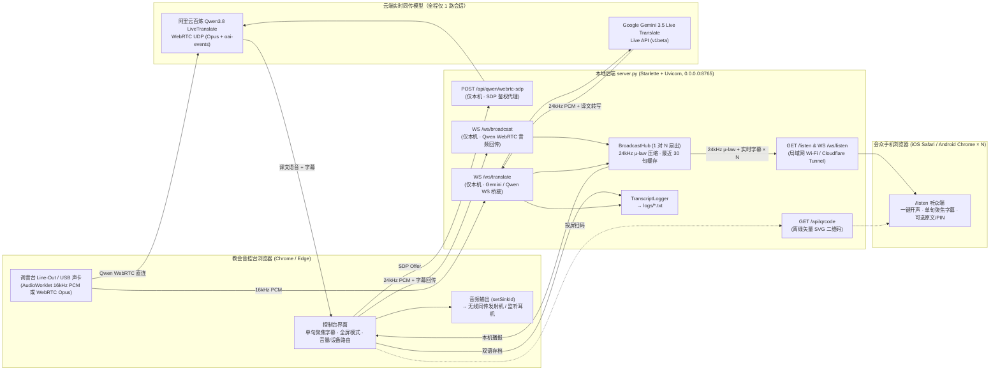

# 教会主日同声传译台 · Sermon Live Translator

> 面向华人教会主日讲道与聚会场景打造的**实时双向语音同声传译系统**（中文普通话 ↔ 美式英语）。  
> 同时支持 **模式 1（音控台本地单机 / 无线发射机直出）** 与 **模式 2（1 对 N 会众手机扫码收听，全教会共享 1 路 API 费用）**，内置 **阿里云百炼 `Qwen3.8-LiveTranslate`（WebRTC UDP 直连）** 与 **Google `Gemini 3.5 Live Translate`** 一键切换对比。

---

## 目录

- [核心特性](#核心特性)
- [支持模型与费用参考](#支持模型与费用参考)
- [系统架构](#系统架构)
- [快速开始](#快速开始)
- [配置 API Key 与百炼业务空间](#配置-api-key-与百炼业务空间)
- [模式 2：会众手机扫码收听指南（Wi-Fi 与 5G）](#模式-2会众手机扫码收听指南wi-fi-与-5g)
- [教会音控台实战配置指南](#教会音控台实战配置指南)
- [项目结构](#项目结构)
- [本地开发与测试](#本地开发与测试)
- [安全与隐私说明](#安全与隐私说明)
- [路线图（Roadmap）](#路线图roadmap)
- [开源协议](#开源协议)

---

## 核心特性

### 1. 双引擎实时语音同传（一键切换对比）
- **阿里云百炼 `qwen3.8-livetranslate-flash-realtime`（默认）**
  - 原生 **WebRTC UDP 直连**（与通义官网同协议），大幅降低跨洋网络抖动与队头阻塞；同时保留 WebSocket 兜底通道。
  - 支持 **实时声音复刻（默认免费 `clone_once`）**，自动贴合讲员男声/女声；亦可选内置女声 `Tina`、持续复刻 `clone_always` 或预注册自定义音色 ID。
  - 内置基督教中英双语神学术语词典（`translation.corpus.phrases`），并自动解析合并「本周讲道预热」中的临时术语与经文人名。
  - 支持 `stash` 临时预测字幕流式预览，减少长句等待感。
- **Google `gemini-3.5-live-translate-preview`**
  - 连续流式语音同传，完整支持自定义自由文本口译规则（`system_instruction`）与本周讲道背景注入。
  - 内置 **智能自动分段引擎**：在自然句末（`. ! ? 。 ！ ？`）与停顿间隙自动分段，避开经文缩写与小数点误切（如 `Rom. 8`、`Dr. Lin`、`3.14`），解决连续输出无换行的问题。
  - 内置上下文滑动窗口压缩（`context_window_compression`）与断点无缝续传（`session_resumption`），保障 45–60 分钟整堂讲道不断流。

### 2. 双向同传与独立术语管理
- 一键切换 **中译英（普通话 → 美式英语）** 与 **英译中（英语 → 简体中文）**。
- 两个方向各自独立保存默认神学术语词表（称义 / justification、成圣 / sanctification、和合本/ESV 圣经书卷与人名等）与口译规则。

### 3. 广播级字幕体验
- **单句柔和聚焦高亮（Active Sentence Focus）**：当前正在播报的译文句子保持 100% 清晰高亮 + 左侧蓝色聚焦竖条 + `播报中` 动态徽标；已播报完的历史句柔和变暗（悬停自动恢复清晰），无逐词抖动或偏移。
- **双字幕分屏面板**：上方主同传译文字幕 + 下方源语言转写参考，支持上下拖拽分隔条自由调整高度、双击恢复默认比例或一键收起参考栏。
- **全屏投屏大字幕模式**：专为教会大屏投影或副屏监听设计，历史句弱化、当前句纯白加粗聚焦，支持深色/浅色主题切换与字号调节。

### 4. 音控台专业音频链路与运维工具
- **调音台 / Line-Out 纯净直采模式**：支持一键关闭浏览器回声消除（AEC）、降噪（NS）和自动增益（AGC），避免调音台高质量线路信号被浏览器算法误伤。
- **独立输出设备路由（`setSinkId`）**：在 Chrome / Edge 中可将译文语音定向输出到指定的 USB 声卡或无线同传发射机，与电脑系统提示音完全隔离。
- **唱诗 / 祷告一键暂停**：暂停推流而不中断连接，避免诗歌伴奏触发无意义翻译与计费。
- **实时用量与费用估算**：按模型实际回传 Token 精确计算会话费用（区分 Qwen3.8 会话累计 Token 与 Gemini 音频 Token），并在状态栏实时显示。
- **本地双语存档与密钥管理**：自动按时间戳将双语讲道文字稿保存到 `logs/`；网页端支持分别保存或一键清空 `DASHSCOPE_API_KEY` 与 `GEMINI_API_KEY`（同步持久化到 `.env`）。

### 5. 模式 2：1 对 N 会众手机扫码广播（全教会仅消耗 1 路 API 费用）
- **单路译文扇出分发**：无论音控台使用 Qwen3.8 WebRTC 还是 Gemini 3.5，所有扫码连接的会众手机都通过本地后端 `BroadcastHub` 共享**同一路**翻译语音与实时字幕，不随人数增加 API 费用。
- **高效低带宽音频压缩**：下行广播自动将 24kHz 译文 PCM 实时编码为 24kHz G.711 μ-law（带宽减半、每台手机约 192 kbps），每台手机拥有独立有界发送队列，单台弱网手机绝不拖慢其他听众。
- **离线大屏二维码 + 5G 公网穿透兼容**：音控台自动探测教会局域网 IP 并生成离线矢量二维码（无需外部 CDN），点击「投屏扫码二维码」可直接投到大屏；同时支持填入 Cloudflare Tunnel 公网网址供 5G 手机听众扫码收听。
- **iPhone Safari / Android Chrome 深度适配**：`/listen` 听众端支持一键解锁移动端音频策略、防息屏 `Wake Lock`、中途扫码自动补发最近 30 句字幕、可选显示/隐藏原文、手动上滑查看经文时暂停自动滚动、断网自动重连与可选 4 位房间口令（PIN）。
- **零信任音控台隔离**：服务监听 `0.0.0.0:8765` 时，所有管理与密钥接口严格限定仅允许本机直连（自动拦截局域网与 Cloudflare Tunnel `CF-Connecting-IP` / `X-Forwarded-For` 访问），外部手机访问根路径 `/` 会自动 302 跳转至 `/listen`。

---

## 支持模型与费用参考

| 维度 | 阿里云百炼 `qwen3.8-livetranslate-flash-realtime`（默认） | Google `gemini-3.5-live-translate-preview` |
| --- | --- | --- |
| **传输协议** | WebRTC UDP 直连（需配置业务空间 ID）/ WebSocket 兜底 | WebSocket 实时流（后端经 `google-genai` SDK 转发） |
| **支持区域** | 北京 `cn-beijing` / 新加坡 `ap-southeast-1` | Google AI Studio 全球节点（北美 TCP 延迟约 32ms） |
| **定制能力** | 神学术语词表 `corpus.phrases`（最多 900 条） | 完整自然语言口译指令 `system_instruction` + 讲道上下文 |
| **音色选项** | 默认免费实时复刻（自动匹配牧师男/女声）、内置女声 `Tina`、自定义音色 ID | 原生流式译员语音 |
| **分段机制** | 服务端 `server_vad` 自动分句 + `stash` 预览 | 后端智能标点 + 2.2s 停顿自动分段 |
| **官方定价参考** | 北京区：音频输入 ¥40/1M tok、文本输出 ¥100/1M tok、音频输出 ¥160/1M tok | 音频输入 \$3.50/1M tok、音频输出 \$21.00/1M tok（25 tok/s） |
| **1 小时讲道实测估算** | 实测约 **¥0.14/分钟 ≈ ¥8.4/小时**（无历史上下文重复计费） | 基准约 **\$0.037/分钟 ≈ \$2.2/小时**（开启上下文压缩后可控） |

> 注：以上费用基于官方公开单价与实测讲道流估算，具体以阿里云百炼或 Google AI Studio 账单为准。

---

## 系统架构



---

## 快速开始

### 环境要求

- **操作系统**：macOS / Linux / Windows（WSL 或 Git Bash）
- **Python**：3.11 或更高版本
- **浏览器**：推荐使用 **Google Chrome** 或 **Microsoft Edge**（仅 Chromium 系浏览器完整支持 `AudioWorklet` + `setSinkId` 独立音频输出设备路由）

### 安装与启动

```bash
# 1. 克隆仓库
git clone https://github.com/boyang0830/sermon-live-translator.git
cd sermon-live-translator

# 2. 一键创建虚拟环境、安装依赖并启动服务
./start.sh
```

`start.sh` 会自动完成以下工作：
1. 若 `.venv/` 不存在，自动创建 Python 虚拟环境并安装 `requirements.txt` 中的依赖；
2. 若 `.env` 不存在，自动从 `.env.example` 复制一份初始配置；
3. 启动本地服务于 `http://127.0.0.1:8765`。

随后在 **Chrome 或 Edge** 中打开：<http://127.0.0.1:8765>

> 如需自定义监听地址或端口，可修改 `.env` 中的 `HOST` 和 `PORT`，或直接运行：
> ```bash
> .venv/bin/uvicorn server:app --host 127.0.0.1 --port 8765
> ```

---

## 配置 API Key 与百炼业务空间

你可以直接在网页右上角「配置面板」中粘贴并保存 API Key（会自动写入本地 `.env` 并支持一键清空），也可以手动编辑项目根目录下的 `.env` 文件：

```dotenv
# 1. 阿里云百炼 Qwen3.8-LiveTranslate（默认推荐）
DASHSCOPE_API_KEY=your_dashscope_api_key_here
DASHSCOPE_REGION=cn-beijing
# 启用 WebRTC UDP 低延迟直连必填（可在百炼控制台左上角「业务空间」查看，形如 ws-xxxxxxxx 或 llm-xxxxxxxx）
DASHSCOPE_WORKSPACE_ID=your_workspace_id_here

# 2. Google AI Studio — Gemini 3.5 Live Translate（备选对比）
GEMINI_API_KEY=your_google_ai_studio_api_key_here

# 3. 本地服务地址与端口
HOST=127.0.0.1
PORT=8765
```

### 获取方式说明

- **阿里云百炼（Qwen3.8）**
  1. 登录 [阿里云百炼控制台](https://bailian.console.aliyun.com/) 创建 API Key 并填入 `DASHSCOPE_API_KEY`。
  2. 在百炼控制台左上角点击「业务空间」查看你的业务空间 ID（通常以 `ws-` 或 `llm-` 开头），填入 `DASHSCOPE_WORKSPACE_ID`。
     - 填写业务空间 ID 后，应用将自动使用 **WebRTC UDP 直连**（`https://{WorkspaceId}.{region}.maas.aliyuncs.com/api/v1/webrtc/realtime`），延迟显著低于 WebSocket。
     - 若未填写，可切换为 WebSocket 传输模式。
  3. 区域选择：中国大陆账号选 `cn-beijing`，国际站账号选 `ap-southeast-1`。
- **Google AI Studio（Gemini 3.5）**
  1. 登录 [Google AI Studio](https://aistudio.google.com/apikey) 创建 API Key 并填入 `GEMINI_API_KEY`。
  2. 网页端选择 `gemini-3.5-live-translate-preview` 即可实时切换对比。

---

## 模式 2：会众手机扫码收听指南（Wi-Fi 与 5G）

`./start.sh` 默认监听 `0.0.0.0:8765`，同时启动音控台（本机专用）与会众广播服务：

### 方案 A：教会局域网 Wi-Fi（推荐，零成本最低延迟）
1. 音控电脑与会众手机连接同一个教会 Wi-Fi。
2. 音控同工在本机 Chrome/Edge 打开 `http://127.0.0.1:8765`，左侧「会众手机广播 · Mode 2」卡片会自动显示本机局域网收听地址（例如 `http://192.168.1.50:8765/listen`）。
3. 点击 **「投屏扫码二维码」** 将二维码投到主屏幕，会众用手机相机扫码即可直接进入收听页面，点击 **「点击开启实时语音播报」** 并佩戴耳机收听。
4. 音控台顶栏与广播卡片会实时显示当前 **`🎧 在线听众人数`**；如果不需要本地音箱发声（仅给手机广播），可在音控台点击「静音输出」，不会影响会众手机端的广播音频。

### 方案 B：兼容 5G / 蜂窝网络（通过 Cloudflare Tunnel 一键公网访问）
如果教会 Wi-Fi 拥挤或部分会众习惯使用手机 5G 流量，可在音控电脑另开一个终端运行免费隧道（无需公网 IP 或买服务器）：

```bash
# 安装一次即可（macOS）
brew install cloudflared

# 启动临时 HTTPS 公网隧道（或绑定自己的免费 Cloudflare 固定子域名）
cloudflared tunnel --url http://127.0.0.1:8765
```

1. 复制终端输出的 `https://xxxx.trycloudflare.com` 网址。
2. 粘贴到音控台「会众手机广播」→「公网穿透地址」并点击 **保存**，二维码与收听链接会立即自动切换为公网 HTTPS 地址。
3. 外网用户即使直接打开根域名 `https://xxxx.trycloudflare.com`，也会被自动重定向到 `/listen`；所有管理与密钥接口均被后端自动拦截（HTTP 403）。

### 可选房间口令（PIN）
- 默认留空：会众扫码直接进入，体验最顺畅。
- 如需防止非本堂人员访问（尤其开启公网隧道时）：在音控台填入 4–12 位数字或字母（如 `2026`）点保存，大屏二维码弹窗会自动显示口令，手机端输入一次即可加入。

---

## 教会音控台实战配置指南

### 1. 音频输入（强烈推荐调音台直连）
- 从教会主调音台的 **Aux Send / Direct Out / Monitor Out** 输出一路**仅包含讲员麦克风**的干净音频信号（不混入敬拜乐队与会众环境声），经 USB 声卡接入音控电脑。
- 在网页「音频设置」中选择该 USB 声卡作为麦克风输入，并开启 **「调音台 / Line-Out 纯净模式」**（禁用浏览器的回声消除、降噪与自动增益，防止讲员停顿或语调起伏被误剪）。

### 2. 音频输出（独立路由到无线同传发射机）
- 将无线同传发射机（如 FM / 2.4GHz 导览发射机）连接到独立的 USB 声卡或耳机口。
- 在网页「音频输出设备」下拉菜单中指定该设备（Chrome/Edge 支持），即可确保仅同传语音进入发射机，电脑其他系统声音不会干扰会众收听。

### 3. 主日服事标准流程
1. **聚会前 10 分钟**：在「本周讲道预热」中输入今日讲道题目、核心经文与专有名词（如 `罗8:1-11`、`保罗=Paul`、`称义=justification`），试讲 2–3 句确认输入电平正常、耳机可清晰听到译文。
2. **敬拜唱诗 / 会众祷告时**：点击 **「暂停推流（唱诗/祷告）」** 按钮，防止音乐与合唱造成杂乱翻译或无效扣费。
3. **讲道开始**：恢复推流，按需点击「全屏字幕」投送到副屏或直播字幕层。
4. **聚会结束后**：点击「停止翻译」，双语完整文字稿已自动保存至本地 `logs/sermon_<direction>_<timestamp>.txt`。

---

## 项目结构

```text
sermon-live-translator/
├── server.py                     # Starlette + Uvicorn 后端（Qwen WebRTC SDP 代理、Gemini/Qwen WS 桥接、智能分段、费用核算、日志落盘）
├── start.sh                      # 一键启动脚本（自动建 venv、装依赖、初始化 .env）
├── requirements.txt              # Python 依赖清单
├── .env.example                  # 环境变量配置模板
├── .gitignore                    # 忽略 .env、.venv/、logs/ 等敏感与运行文件
├── LICENSE                       # MIT 开源协议
├── README.md                     # 项目说明文档
├── static/
│   ├── index.html                # 音控台主界面、模式 2 广播控制与大屏二维码弹窗
│   ├── styles.css                # 音控台样式（深浅双主题、单句聚焦高亮、可拖拽双栏布局、QR 弹窗）
│   ├── app.js                    # 音控台状态管理、音频路由、Qwen WebRTC 广播回传与二维码控制
│   ├── listen.html               # 会众手机端收听页面（/listen，iOS Safari / Android Chrome 适配）
│   ├── listen.css                # 会众手机端响应式样式（单句聚焦、安全区底部控制栏）
│   ├── listen.js                 # 会众手机端 WebSocket 接收、μ-law 解码播报、防息屏与断线重连
│   ├── qwen-webrtc.js            # 浏览器原生 Qwen3.8 WebRTC UDP 客户端（含 24kHz 广播音频采集）
│   ├── audio-capture-worklet.js  # 可配置采样率（16kHz / 24kHz）AudioWorklet 音频采集器
│   └── audio-player.js           # 24kHz 低延迟流式音频播放器（支持 PCM16 + G.711 μ-law 与延迟追帧）
└── tests/
    └── test_server.py            # 后端单元测试（含模式 2 1-to-N 扇出、μ-law 压缩、PIN 校验与隧道安全隔离）
```

---

## 本地开发与测试

运行全部后端单元测试与前端语法检查：

```bash
# 运行 pytest 单元测试
.venv/bin/python -m pytest -v

# 检查前端 JavaScript 语法
node --check static/audio-capture-worklet.js
node --input-type=module --check < static/audio-player.js
node --input-type=module --check < static/qwen-webrtc.js
node --input-type=module --check < static/app.js
```

### 主要 HTTP / WebSocket 接口

| 接口 | 权限 | 说明 |
| --- | --- | --- |
| `GET /` | 仅本机 | 音控台 Web 前端页面（非本机或经公网代理访问自动 302 跳转至 `/listen`） |
| `GET /listen` | 公开 | 会众手机收听页面（支持 Wi-Fi 与 5G 隧道） |
| `GET /api/health` | 公开 | 健康检查 |
| `GET /api/broadcast/status` | 公开 / 本机增强 | 返回直播状态与在线人数（仅本机请求额外返回局域网 IP、口令与管理配置） |
| `GET /api/qrcode` | 公开 | 离线生成 Crisp SVG 扫码二维码 |
| `POST /api/broadcast/settings` | 仅本机 | 更新房间口令 PIN 与公网穿透地址（同步保存至 `.env`） |
| `GET /api/config` | 仅本机 | 返回模型列表、方向配置、默认术语表与已配置密钥状态（不回传明文密钥） |
| `POST /api/keys` | 仅本机 | 保存或清空 `GEMINI_API_KEY` / `DASHSCOPE_API_KEY`（同步更新 `.env`） |
| `POST /api/qwen/webrtc-sdp` | 仅本机 | 代理浏览器 WebRTC SDP Offer 到阿里云百炼实时接口（隐藏 API Key） |
| `POST /api/transcript/log` | 仅本机 | 接收并追加保存 WebRTC 模式下的双语文字稿到 `logs/` |
| `WS /ws/translate` | 仅本机 | 音控台 WebSocket 实时同传通道（Gemini 3.5 / Qwen3.8 WS） |
| `WS /ws/broadcast` | 仅本机 | 音控台 Qwen3.8 WebRTC 译文音频（24kHz PCM）与字幕回传通道 |
| `WS /ws/listen` | 公开（可选 PIN） | 会众手机 1 对 N 实时广播下行通道（24kHz μ-law 语音 + 实时字幕 + 历史补发） |

---

## 安全与隐私说明

- **严禁提交密钥与讲道记录**：`.gitignore` 已默认排除 `.env` 与 `logs/`，推送代码前请勿强制添加这两个路径。
- **密钥隔离**：浏览器端无法读取 `.env` 中的明文 API Key；Qwen3.8 WebRTC 鉴权由本地后端代理完成。
- **本机音控台硬隔离**：尽管默认监听 `0.0.0.0:8765` 以支持局域网手机扫码，但所有控制、配置、密钥与推流接口均校验请求必须来自本机回环地址且不含反向代理头（`CF-Connecting-IP`、`X-Forwarded-For` 等），防止教会 Wi-Fi 或公网隧道中的手机越权访问音控台。

---

## 路线图（Roadmap）

- [x] **模式 1：音控台本地单机版**
  - [x] 阿里云百炼 Qwen3.8 WebRTC UDP 直连与实时声音复刻
  - [x] Google Gemini 3.5 Live Translate 接入与智能标点/停顿自动分段
  - [x] 中英双向切换、神学术语库与本周讲道预热
  - [x] 单句柔和聚焦高亮、全屏字幕投屏与可拖拽双栏字幕区
  - [x] 实时费用核算、API Key 持久化/清空与双语本地归档
- [x] **模式 2：1 对 N 会众手机扫码收听**
  - [x] 音控台单路采集翻译，后端经 `BroadcastHub` 扇出分发给全教会手机（仅消耗 1 路 API 费用）
  - [x] 兼容 Qwen3.8 WebRTC（24kHz 音频回传）与 Gemini 3.5 双引擎，自动 G.711 μ-law 压缩节省 50% Wi-Fi 带宽
  - [x] 轻量化手机听众端 `/listen`（一键解锁音频、防息屏、中途加入补发历史字幕、可选原文与 4 位房间口令）
  - [x] 音控台离线大屏扫码二维码 + 局域网 Wi-Fi 与 Cloudflare Tunnel 5G 穿透双模式 + 音控台安全隔离
- [ ] **未来增强（模式 3 设想）**
  - [ ] 多目标语言同时广播（例如同一堂讲道同时输出英文、粤语、西班牙语多频道供会众自选）
  - [ ] 讲道结束后一键生成双语讲道摘要与经文索引卡片

---

## 开源协议

本项目基于 [MIT License](LICENSE) 开源。
